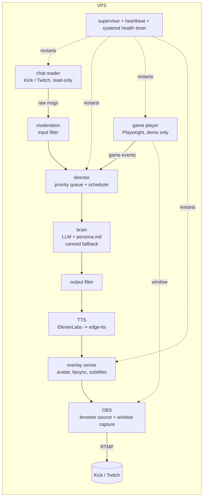

# Hubie, live 24/7 (Housebets contest entry)

An AI streamer that plays House originals in **demo mode**, talks with chat and runs with **no human** on Kick or Twitch.

## Architecture


## One-page setup
1. VPS (Ubuntu 22.04+, 2 vCPU/4 GB), then `sudo apt install -y xvfb obs-studio ffmpeg python3-venv`.
2. `git clone <repo> /opt/hubie-streamer && cd /opt/hubie-streamer`
3. `python3 -m venv .venv && .venv/bin/pip install -r requirements.txt && .venv/bin/playwright install --with-deps chromium`
4. `cp .env.example .env` and fill in `DEEPSEEK_API_KEY` (or `ANTHROPIC_API_KEY` if `llm_provider: anthropic`; ElevenLabs optional). **Never commit `.env`.**
5. Mascot: `overlay/avatar/mascot.webm` (transparent VP9 video) is shown by `overlay/index.html`. (Older still-image avatar notes: (1) `closed.png` + `open.png` (official art, mouth shut/open, lip-sync) -> (2) `mascot.png` (single full-body image, sways and glows with speech) -> (3) `closed.svg`/`open.svg` placeholder. The current `mascot.png` is a self-made placeholder mascot (surfing), NOT the official Hubie.) To swap, drop the art from `hubie-art-pack.zip` into `overlay/avatar/` as `closed.png` and `open.png` (mouth shut/open); PNG wins automatically, no code change. Edit `persona.md` with Hubie's real personality and the voice notes. Set `voice` in `config.yaml`.
6. Edit `config.yaml`: platform, channel, game URLs and selectors (inspect each housebets.com/games page; demo mode only).
7. Start a virtual display: `Xvfb :99 -screen 0 1280x720x24 &` and `export DISPLAY=:99`.
8. OBS: Scene with (a) Browser Source `http://localhost:8000` 1280x720, tick "Control audio via OBS"; (b) Window Capture of the Playwright Chromium window. Set stream key (Kick/Twitch) and enable auto-start streaming (`obs --startstreaming --minimize-to-tray`).
9. Run: `.venv/bin/python -m hubie.main`. For 24/7: copy `deploy/*` to `/etc/systemd/system/`, then `systemctl enable --now hubie hubie-health.timer`.

Kick chatroom id: open `https://kick.com/api/v2/channels/<your-channel>` in a browser and read `chatroom.id`.

## Safety
Chat input filter (links, scams, jailbreaks, slurs, per-user cooldown), output filter (no win promises/deposit talk), persistent 18+ banner, scheduled responsible-gambling reminders, player refuses wallet/deposit/login clicks. Demo mode only.


## Stream chat moderation
The public overlay feed shows only viewer comments and Hubie replies. Filtered messages are never shown; the green Moderated badge increments its filtered counter. Hubie chat replies are prompted to address each viewer by their exact name. Dice/game events and system logs are kept out of the chat feed.


## AI demo chat
When `simulated_chat: true`, the demo uses 15 rotating viewer names. The configured DeepSeek brain generates fresh viewer questions/comments, then Hubie answers the actual message by name. Delays are randomized between `demo_chat_min_delay_sec` and `demo_chat_max_delay_sec`. If the AI API is temporarily unavailable, the demo safely falls back to varied local prompts.


## Autonomous AI streamer pipeline (before live streaming)

```text
Simulated/real chat -> Moderator -> AI Brain -> Director -> TTS -> Overlay
Demo game -----------> Director -> AI commentary -> TTS -> Overlay
Health/heartbeat ----> Supervisor -> automatic component restart
```

Included in this build:
- 15 rotating demo viewer identities with AI-generated questions/comments and anti-repeat history.
- Question-aware Hubie replies by username, with local smart fallbacks if the AI API is unavailable.
- Game-result commentary, rotating segment themes, idle conversation and periodic safety reminders.
- Voice pipeline: ElevenLabs when configured, otherwise free Edge TTS.
- Overlay events for `idle`, `talking`, `reacting`, and `excited` avatar states.
- Input/output moderation and filtered-message counting.
- Supervisor and heartbeat recovery for the local agents.

Live platform broadcasting is intentionally not configured in this package yet. It should be added only after the local autonomous run is stable.
